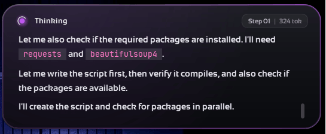
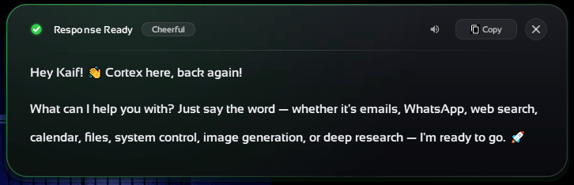

# 🧠 Cortex: The Autonomous Desktop Agent

> **An Open-Source AI Operating System that controls your PC, executes terminal commands, manages files, sends WhatsApp/Email, and remembers your life — powered by Meta's Muse Spark Open via Baseten.**

[]()
[]()
[]()
[]()
[]()

---

## 🏆 Built for the Meta Global AI Developer Hackathon
This project was built from scratch during the hackathon (Oct 26 – Nov 4, 2026) to push the boundaries of what AI agents can do on a local operating system. It specifically targets the **"Build for Your World"** and **"Push the Frontier"** problem statements.

### 🚀 What Was Built During the Hackathon (New Work)
While the foundational idea of a local agent existed, the following core components were specifically engineered during the 10-day hackathon:
*   **Meta Muse Spark Integration:** Built a provider-agnostic `BasetenProvider` to handle the `meta-models/muse-spark-open-1026` model, utilizing its native tool-calling and reasoning capabilities.
*   **Advanced Truncation Self-Correction:** Engineered a custom parser that detects broken JSON mid-stream and forces the agent to retry with smaller payloads.
*   **Real-time Mid-Execution Correction:** Implemented a ZeroMQ-based live feedback loop allowing users to interrupt and redirect the agent mid-task.
*   **GUI Grounding (OCR + UIA):** Built a Set-of-Mark (SoM) visual grounding system that maps screen elements to precise bounding boxes.
*   **ZeroMQ IPC Architecture:** Decoupled the heavy AI loop from the PyQt5 UI for zero-latency, asynchronous UI updates.

---

## 💡 Why Cortex? (Impact)
Current AI assistants (ChatGPT, Claude web) are trapped inside browsers. They can't open your apps, organize your files, send an actual WhatsApp message, or interact with your OS. 

**Cortex bridges the gap between LLM intelligence and OS-level execution.**

*   **For Developers:** *"Clone this repo, install dependencies, fix the failing test, and push a commit."* Cortex actually executes it.
*   **For Power Users:** *"Check my emails, find the WiFi password, and WhatsApp it to my dad."* Cortex plans this multi-step workflow and executes it with a Human-in-the-Loop approval gate.
*   **Zero-Cloud Latency:** Runs entirely on your local machine as a background service. Summon it anywhere using `Ctrl+Shift+J`.

---

## 🧠 Use of Meta AI Tooling (The Muse Spark Engine)
Cortex is powered natively by **Meta's Muse Spark Open (`meta-models/muse-spark-open-1026`)** hosted on **Baseten**. We didn't just build a wrapper; we deeply integrated the model's core strengths:

1.  **Native Agentic Reasoning:** Muse Spark's massive context window allows Cortex to maintain a 300-step scratchpad, managing complex multi-tool workflows without losing state.
2.  **Robust Tool Calling:** The model maps complex intents to **13 specialized OS tools** (Terminal, Python, GUI, Email, Comms, etc.) with high accuracy.
3.  **Dynamic Prompting:** The agent injects "Live Overrides" (user interruptions), "Budget Tracking" (step limits), and "Confirmed Facts" into the Muse Spark context every step.

---

## 🏛️ Cortex Architecture (The Pyramid)

Our system is built on a robust, layered architecture ensuring stability, speed, and safety.

```mermaid
graph TD
    %% Styling
    classDef user fill:#0467DF,stroke:#fff,stroke-width:2px,color:#fff;
    classDef ui fill:#3772FF,stroke:#fff,stroke-width:2px,color:#fff;
    classDef core fill:#FF4E00,stroke:#fff,stroke-width:2px,color:#fff;
    classDef llm fill:#0668E1,stroke:#fff,stroke-width:2px,color:#fff;
    classDef tools fill:#2F3136,stroke:#fff,stroke-width:2px,color:#fff;
    classDef memory fill:#10B981,stroke:#fff,stroke-width:2px,color:#fff;

    %% Nodes
    User["👤 User (Hotkey Ctrl+Shift+J / CLI)"]:::user

    subgraph UI_Layer ["🖥️ UI Layer (PyQt5 + ZeroMQ)"]
        UI_Panel["Agent Panel (Streaming)"]:::ui
        UI_Input["Input Popup (Glassmorphism)"]:::ui
        UI_Approve["Approval Gate (Email/WhatsApp)"]:::ui
    end

    subgraph Core_Engine ["🧠 Agentic Brain (Core Engine)"]
        Brain["Iterative Loop (300 Steps)\nSelf-Correction & Truncation Detection"]:::core
    end

    subgraph LLM_Providers ["☁️ LLM Providers"]
        Meta_Muse["Meta Muse Spark Open\n(Baseten Inference - Primary)"]:::llm
        Fallback["Fallback LLM\n(Ollama / OpenAI Compatible)"]:::llm
    end

    subgraph Tool_Registry ["🛠️ 13 OS Tools (Parallel Execution)"]
        T_System["System Controller"]:::tools
        T_Terminal["Terminal & Python Exec"]:::tools
        T_File["File Operations"]:::tools
        T_GUI["GUI Grounding (OCR+UIA)"]:::tools
        T_Comms["Email / WhatsApp / Telegram"]:::tools
        T_Search["Web & Deep Research"]:::tools
    end

    subgraph Memory_System ["💾 Hybrid Memory"]
        Mem_Graph["Lifetime Graph (NetworkX)"]:::memory
        Mem_Vector["Vector Embeddings (BGE)"]:::memory
    end

    %% Connections
    User <-->|Interacts| UI_Layer
    UI_Layer <-->|Async IPC| Core_Engine
    Core_Engine <-->|Reasons & Plans| LLM_Providers
    Core_Engine <-->|Executes| Tool_Registry
    Core_Engine <-->|Recalls/Stores| Memory_System
    Tool_Registry -.->|Streams Status| UI_Layer
    
    %% Link Styles
    linkStyle 0,1,2,3,4 stroke:#666,stroke-width:2px,color:#fff;
    linkStyle 5 stroke:#FF4E00,stroke-width:2px,stroke-dasharray: 5 5;
```
---

## 🛠️ Technical Depth & Execution

Cortex is engineered with a ruthless focus on **reliability, non-hallucination, and safety**.

### 1. The Agentic Brain (Fault Tolerance)
*   **Truncation Detection:** LLMs frequently truncate large JSON tool calls. Cortex detects unclosed braces/empty dicts mid-stream and forces a smaller retry.
*   **Duplicate Action Blocking:** Fingerprinted `(tool_name, args_hash)` sets prevent the agent from accidentally sending the same email or running the same command twice.
*   **Panic Step Protocol:** If the agent hits its 300-step limit, it forces a synthesis of completed actions rather than failing silently.

### 2. Advanced GUI Grounding (Vision)
*   **Set-of-Mark (SoM) Prompting:** Screenshots are analyzed via RapidOCR and UI Automation (UIA), merged, and fed to the model with numbered bounding boxes.
*   **Strict Verification:** The model must provide an `element_id` AND `expected_text`. If similarity is < 88%, the click is rejected to prevent catastrophic misclicks.

### 3. Hybrid Memory System
*   **Lifetime Graph:** A `NetworkX` MultiDiGraph stores personal facts (e.g., `User -> [FATHER] -> Rajesh`).
*   **Vector Search:** Uses `BAAI/bge-small-en-v1.5` embeddings for semantic retrieval of past conversations.

### 4. Cross-Platform Safety Layer
*   **Command Blocklist:** Every terminal command is parsed with `shlex`. Destructive commands (`rm -rf /`, `format C:`, `mkfs`) are hard-blocked.
*   **Approval Gates:** Before sending any Email, WhatsApp, or Telegram message, a ZeroMQ popup opens for the user to review and edit the draft.

---

## 📸 Screenshots & Demo

Here is a glimpse of the Cortex UI in action:

<p align="center">
  
  <br>
  <i>Agent Panel: Real-time thought stream with tool execution status.</i>
</p>

<p align="center">
  
  <br>
  <i>Input Popup: Glassmorphism input with global hotkey `Ctrl+Shift+J`.</i>
</p>

<p align="center">
  
  <br>
  <i>Typing Popup: Editable draft before sending emails or messages.</i>
</p>

🎥 **Watch the 3-Minute Demo Video Here:** *[Insert YouTube/Loom Link Here]*

---

## ⚙️ Quick Start (Local Setup)

### 1. Requirements
*   Python 3.10+
*   Node.js 20+ (for WhatsApp Baileys bridge)
*   Meta Muse Spark Open API Key (via Baseten)

### 2. Installation
```bash
git clone https://github.com/thekaifansari01/cortex-meta-agent.git
cd cortex-meta-agent
python -m venv .venv
.venv\Scripts\activate
pip install -r requirements.txt
cd tools/Messanger/whatsapp/BaileysServer && npm install && cd ../../../..
python SetupRegistry.py # Run as Admin
```

### 3. Environment Variables
Create a `.env` file in the root:
```env
# ── Primary LLM: Meta Muse Spark Open (Baseten) ──
BASTEN_API_KEY="your_baseten_api_key_here"
BASTEN_BASE_URL="https://inference.baseten.co/v1"
BASTEN_MODEL="meta-models/muse-spark-open-1026"
AGENT_PRIMARY_PROVIDER="basten"

# ── Fallback LLM (Any OpenAI-compatible endpoint) ──
CUSTOM_API_KEY=""
CUSTOM_BASE_URL=""
CUSTOM_MODEL=""
AGENT_FALLBACK_PROVIDER="custom"
```

### 4. Run Cortex
```bash
cortex
```
*Press `Ctrl+Shift+J` anywhere in Windows to summon the input popup.*

---

## 🛠️ Tool Inventory (13 Tools)

| Tool | Description |
|------|-------------|
| `system_controller` | App/URL control, YouTube play, system actions (lock, sleep, volume). |
| `terminal_command` | PowerShell/Bash with stateful session and safety blocklist. |
| `run_python_code` | Sandboxed Python execution via temp file. |
| `file_operations` | File CRUD, repo mapping, inline image view, exact-block replace. |
| `gui_controller` | OCR + UIA grounded computer control (click, type, scroll). |
| `email_action` | Gmail send with attachments, fetch by date + query filter. |
| `whatsapp_action` | WhatsApp send (text/file), fetch chat by date. |
| `telegram_action` | Telegram send (multi-file), fetch chat by date. |
| `calendar_action` | Google Calendar CRUD, disambiguates multi-matches. |
| `image_command` | Image generation and editing. |
| `search_actions` | Parallel Tavily web + arXiv + YouTube scraper. |
| `clipboard_action` | Clipboard read/write. |
| `memory_actions` | Two-tier memory retrieval (session + graph). |

---
<div align="center">
  <i>Built with ❤️ by Kaif Ansari for the Meta Global AI Developer Hackathon 2026.</i>
  <br>
  <b>Powered by Meta Muse Spark Open (Baseten Inference)</b>
</div>